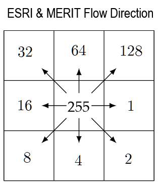

# Data directory contents for the Python package `delineator`

This folder contains geodata files needed by the software.

The file `megabasins.db` is a SQLite database containing geodata for the global
megabasins associated with the hydrography datasets MERIT-Hydro and MERIT-Basins.
When you run `delineator`, one of the first things it does is to determine in which
of the 60 megabasins the user's requested watershed outlet (lat, lng) is located.
It uses the spatialite format and contains 60 vector MultiPolygons. One can 
easily view the data in QGIS or other GIS software.

The four other data files are bundled data for Iceland that let you start using `delineator` as soon as it
is installed, for testing and to demo the software. Iceland is megabasin \#27. 

## Rasters: `.tif` files

- `accum27.tif` - Flow accumulation grid. Each pixel or grid cell represents the number of 
pixels that contribute flow to that pixel. Values range from 1, for cells with no upstream
neighbors, to over 2 million at the mouth of the Jökulsá á Fjöllum River. 

- `fdir27.tif` - Flow direction grid from MERIT-Hydro. Each pixel represents the direction of flow from 
the grid cell. MERIT uses the ESRI standard for repesenting flow in 8 directions (D8). 

| Flow Direction           | Value |
| ------------------------ | ----- |
| river mouth or coastline |    0  |
| → east                   |    1  |
| ↘ southeast              |    2  |
| ↓ south                  |    4  |
| ↙ southwest              |    8  |
| ← west                   |   16  |
| ↖ northwest              |   32  |
| ↑ north                  |   64  |
| ↗ northeast              |  128  |
| inland depression (sink)\* |  -1 or 255  |
| undefined (ocean)\*        |   -9 or 247 |

\*NOTE: MERIT-Hydro flow direction rasters are distributed as signed integer (`Int8`). If a flow direction file is opened as UNSIGNED integer, undefined=247 and inland depression=255. [Source](https://global-hydrodynamics.github.io/MERIT_Hydro/): 

## Vector data: `.db` files

- `basins.db`: Contains the unit catchments geodata. In the case of Iceland, there are 1,973 unit catchments in the table `l0_basins`. The geodata is in spatialite format and has spatial index for fast geoprocessing. The table also contains the network topology data, which indicates how water flows from one catchment to another in the river network, via the field `nextdown`. The nested heirarchical basins geodata are in tables `l1_basins` to `l4_basins`. All features are MultiPolygon type.

- `rivers.db`: Contains the river centerline geodata. Not essential for creating watersheds, but useful for visualization.